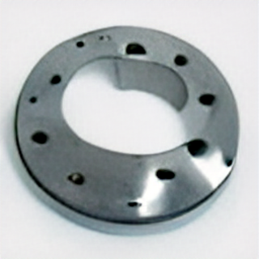

 # web-component-boilerplate

 ---

Licensed under [ISC License](https://opensource.org/licenses/ISC) copyright (c) 2020 [Dan McKeown](https://danmckeown.info).

## Table Of Contents
- [Features](#features)
- [QuickStart](#quickstart)
- [Requirements](#requirements)
- [Usage](#usage)
- [Installation](#installation)
- [Demo](#demo-app)

## features
This project provides the following features:
- Starter for new component-powered web projects powered by [Preact](https://github.com/preactjs/preact) and [htm](https://github.com/developit/htm)
- Builds both pages using [Vite](https://vite.dev/)
- Deploys as a static site without a Node.js server

## quickstart

***
download and build
---

0. git clone `git-url-here`
1. `cd web-component-boilerplate`
2. `npm install`
3. `npm run build`

***
serve the site
---

4. `npm run start` *(previews the production build locally)*
5. Open [http://localhost:5000](http://localhost:5000)

For development, run `npm run dev` and open the URL it prints. Run `npm test` to check both page entry points.

## requirements
- Node.js 20.19+ or 22.12+ (or a newer compatible release)
- npm

## installation
- Check [NodeJS](https://nodejs.org/en/) version: `node --version`
- Check [NPM](https://www.npmjs.com/) version: `npm --version`
- Clone the Git repo: `git clone <repo-url>`

## usage
- Use the code as a scaffold for creating a new site (for example edit app.js or create a new component to import into index.js)
- Run `npm run build` and upload the contents of `dist` to the root of your static web host. The build includes `index.html`, `template0.html`, bundled scripts, the `static` directory, and the favicon. The existing links and Vite's default build assume deployment at the site root.
- Assets in the `static` directory keep their existing `/static` URLs in development and production.
- The previous Snowpack workflow and its `web_modules` directory are no longer used. Import npm dependencies by package name instead.

## demo-app
- Sites using `web-component-boilerplate`
  - [pacificipelican.us](http://pacificpelican.us)
  - [No Such Thing as Normal Podcast web site](https://nosuchthingasnormalpodcast.com/)
- Learn more about the project in [this screencast](https://www.youtube.com/watch?v=lcvIB6ryddE)
